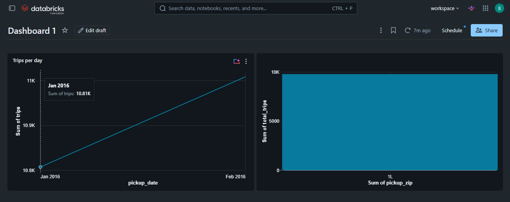

# Lakehouse Claude Analytics


A medallion-architecture data pipeline on Databricks Free Edition, with a Claude-powered text-to-SQL assistant on top of the Gold tables. Transform logic is unit tested, and linting and tests run on GitHub Actions for every push.

> Status: pipeline, tests, CI, dashboard and agent are built. Items marked TODO are measured values to fill in from your own runs.

## Architecture


```
samples.nyctaxi.trips
        |
        v
  Bronze (raw Delta + ingestion metadata)
        |
        v
  Silver (typed, deduplicated, validated)  --->  Quarantine (rejected rows + reason)
        |
        v
  Gold (daily aggregates)
        |
        +--> Databricks SQL dashboard
        |
        +--> Claude text-to-SQL assistant (read-only, guarded)
```

## Tech stack

- Databricks Free Edition (serverless), PySpark, Delta Lake
- Claude API (Anthropic Python SDK) for text-to-SQL
- DuckDB for running the assistant locally on exported Gold tables
- pytest and ruff for tests and linting
- GitHub Actions for CI

## Dataset

Databricks built-in sample data: `samples.nyctaxi.trips` (NYC taxi trips).

- Rows: TODO
- Columns used: `tpep_pickup_datetime`, `tpep_dropoff_datetime`, `pickup_zip`, `dropoff_zip`, `trip_distance`, `fare_amount`
- Source: Databricks sample datasets. Check the Databricks documentation for the dataset's terms before redistributing any data.

## Project structure

```
.
├── src/
│   ├── transforms/
│   │   ├── silver.py          # cleaning and data quality rules
│   │   └── gold.py            # daily aggregates
│   └── agent/
│       ├── ask.py             # Claude text-to-SQL assistant
│       ├── sql_guard.py       # read-only SQL validation
│       └── evaluate.py        # execution-accuracy evaluation
├── notebooks/
│   ├── 01_bronze.py
│   ├── 02_silver.py
│   └── 03_gold.py
├── tests/                     # pytest unit tests
├── eval/
│   ├── questions.json         # 15 evaluation questions with reference SQL
│   └── results.json           # output of the last evaluation run
├── data/sample/               # exported Gold tables (CSV) for local runs
├── docs/                      # architecture diagram, dashboard screenshot
├── .github/workflows/ci.yml   # lint and tests on every push
├── .env.example
├── pyproject.toml
├── requirements.txt
└── README.md
```

## Pipeline layers

All tables are created in `workspace.lakehouse_demo`.

| Layer | What it does | Table(s) |
|-------|--------------|----------|
| Bronze | Copies the raw source data into Delta unchanged and adds `_ingested_at` and `_source_table` | `bronze_trips` |
| Silver | Casts types, removes duplicates, derives trip duration, applies data quality rules | `silver_trips`, `quarantine_trips` |
| Gold | Daily aggregates for dashboards and the assistant | `gold_daily_zone_stats`, `gold_daily_summary` |

Gold tables:

- `gold_daily_zone_stats`: trips, total fare, average fare, average distance and average duration per pickup zip per day
- `gold_daily_summary`: trips, total fare, average fare and active pickup zips per day

### Data quality rules

Rows that fail a rule are written to `quarantine_trips` with the first failing rule in `_reject_reason`. Thresholds are defined in `src/transforms/silver.py`.

| Rule | Rejects when | Rows rejected |
|------|--------------|---------------|
| `null_pickup_time` | pickup time is null | TODO |
| `null_dropoff_time` | dropoff time is null | TODO |
| `dropoff_not_after_pickup` | dropoff is not after pickup | TODO |
| `non_positive_distance` | distance is null or <= 0 | TODO |
| `distance_too_large` | distance > 200 miles | TODO |
| `non_positive_fare` | fare is null or <= 0 | TODO |
| `fare_too_large` | fare > $1000 | TODO |
| `duration_too_long` | duration > 360 minutes | TODO |

Row counts from the last run: Bronze TODO, Silver TODO, Quarantine TODO, removed as duplicates TODO.

Reconciliation: the sum of daily trips in `gold_daily_summary` equals the row count of `silver_trips` (TODO: confirm and record the result of the check in `03_gold.py`).

The thresholds are judgment calls. TODO: note how you checked them against the data and whether you changed them.

## Dashboard



A Databricks SQL dashboard on the Gold tables: trips per day, top 10 pickup zips by trips, and total trips.

## How to run

### 1. Pipeline on Databricks

1. Sign up for Databricks Free Edition.
2. Create a Git folder linked to this repository (Workspace > Create > Git folder).
3. Open each notebook in `notebooks/`, select **Serverless** compute, and run them in order: `01_bronze.py`, `02_silver.py`, `03_gold.py`.
4. If your default catalog is not named `workspace`, change `CATALOG` at the top of each notebook.

### 2. Tests and lint locally

Requires Python 3.10+ and Java (PySpark needs it). On Windows:

```
python -m venv .venv
.venv\Scripts\activate
pip install -r requirements.txt
ruff check .
pytest
```

On macOS or Linux, activate with `source .venv/bin/activate`. The same commands run in CI.

## Claude text-to-SQL assistant

The assistant takes a plain-English question and sends it to Claude together with a description of the two Gold tables. Claude returns one SQL query. The query is validated by `sql_guard.py` (single read-only `SELECT`, Gold tables only) and then executed. Your data rows are never sent to Claude; only the question and the schema description are.

### Setup

1. Export the Gold tables from Databricks as CSV and save them as:
   - `data/sample/gold_daily_summary.csv`
   - `data/sample/gold_daily_zone_stats.csv`
2. Create an API key in the Claude Console (console.anthropic.com).
3. Copy `.env.example` to `.env` in the repo root and set your key. `.env` is git-ignored; never commit it.

   ```
   ANTHROPIC_API_KEY=your-key-here
   ```

### Ask a question

Run from the repo root:

```
python -m src.agent.ask "Which pickup zip had the most trips overall?"
```

The default model is `claude-sonnet-5-5`. Override it with the `ANTHROPIC_MODEL` environment variable or the `--model` flag.

### Safety

The SQL guard blocks multiple statements, write and DDL keywords, and any table other than the two Gold tables. It is a safety net, not a security boundary. For real deployments, run queries with read-only credentials limited to the Gold tables.

### Evaluation

`eval/questions.json` holds 15 questions, each with a hand-written reference query. For each question the evaluator runs Claude's SQL and the reference SQL on the same data and compares the result sets (order-insensitive, numbers rounded to 2 decimals). One question is deliberately unanswerable, to check that the assistant declines properly.

```
python -m src.agent.evaluate
```

Results of the last run (model: TODO, date: TODO):

| Metric | Result |
|--------|--------|
| Test questions | 15 |
| Correct (result matches reference) | TODO |
| Execution accuracy | TODO % |
| Queries that errored or were blocked | TODO |
| Avg latency per question | TODO s |
| Total input / output tokens | TODO / TODO |

TODO: describe the failing questions, why they failed, and what you changed in the prompt if you reran the evaluation. Report only numbers you measured.

## Limitations

- Databricks Free Edition has limited compute and restricted outbound network access. TODO: record whether the Claude API was reachable from Databricks. The assistant here runs locally on exported CSVs.
- The dataset is small and static; there is no streaming ingestion.
- The evaluation set is small (15 questions) and was written by the project author, so accuracy numbers are indicative, not a benchmark.
- Data quality thresholds are heuristics chosen for this dataset.
- TODO: add anything else you found while building.

## Possible next steps

- Incremental processing with Auto Loader
- Databricks Asset Bundles for deployment
- A larger and more varied evaluation set, and a comparison of prompt variants
- Running the assistant inside Databricks if the API is reachable

## License

TODO: choose a license (MIT is common) and add a `LICENSE` file.
